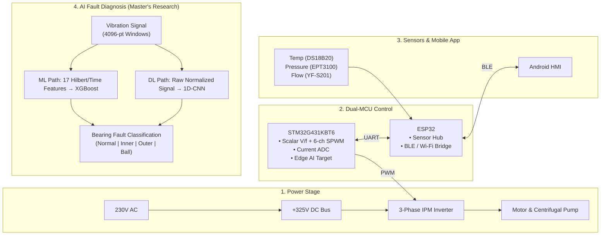

Smart Variable Frequency Drivewith HMI on Android and AI Bearing Fault Detection
# Smart Variable Frequency Drivewith HMI on Android and AI Bearing Fault Detection

> **A 3 kW Variable Frequency Drive (STM32 + ESP32 + Mobile App) extended with Edge AI Predictive Maintenance for Bearing detection.**

## What is this project?

This project is divided into 2 phases : 
1. **Part 1 — Embedded Engineering :** Design and realization of **VFD**, a 3 kW three-phase Variable Frequency Drive for swimming-pool centrifugal pumps. It uses a dual-microcontroller architecture (**STM32G431KBT6** + **ESP32**), real-time $V/f$ motor control, multi-sensor monitoring, and a mobile HMI over Bluetooth Low Energy (BLE).

2. **Part 2 — Predictive Maintenance Research:** Extension of the drive's monitoring layer using **Machine Learning & Deep Learning**. Because the drive already tracks shaft speed ($f_r$) and sensor data, we benchmarked classical ML (**XGBoost, Random Forest, ANN**) against Deep Learning (**1D-CNN, GRU, LSTM, MLP**) on vibration signals to find the best fault-detection model for the drive's STM32 microcontroller.

## How the System Works

## Part 1: VFD Hardware & Embedded Control (Engineering)

### Key Hardware & Firmware Highlights

* **Power Electronics:** Single-phase 230 V AC input rectified to a $+325\text{ V}$ DC bus driving a 3 kW three-phase Intelligent Power Module (**IPM**) with hardware dead-time protection.

* **Real-Time Motor Control (`STM32G431KBT6`):**

  * Executes scalar $V/f$ **control** with **6-channel complementary SPWM** (`TIM1`).

  * Samples phase currents via **ADC** (`ACS712`) for protection and monitoring.

  * Runs at 170 MHz (ARM Cortex-M4 with FPU), leaving compute headroom for Edge AI inference.

* **IoT & Wireless HMI (`ESP32`):**

  * Reads water temperature (**DS18B20**), pressure (**EPT3100**), and flow rate (**YF-S201**).

  * Communicates with the STM32 via a lightweight ** UART protocol** (`Start`, `Stop`, `Speed`, `Status`).

  * Streams live telemetry to an **Android mobile app** over **BLE**.

## Part 2: AI Bearing Fault Diagnosis (Research)

Rolling-element bearings are the #1 cause of motor-pump breakdowns. Localized defects create periodic mechanical impacts that modulate high-frequency structural resonances at known fault frequencies ($f_{\text{BPFI}}, f_{\text{BPFO}}, 2f_{\text{BSF}}$).

### Dataset & Anti-Leakage Validation

* **Benchmark Data:** 40 Drive-End accelerometer recordings from the **Case Western Reserve University (CWRU)** dataset covering 4 classes (**Normal, Inner Race, Outer Race, Ball**), 3 defect sizes ($0.007''$, $0.014''$, $0.021''$), and 4 motor loads ($0\text{--}3\text{ hp}$).

* **Strict File-Level Split:** Splitting overlapping windows randomly causes data leakage (the model memorizes the recording rather than learning fault physics). Instead, **entire files** are separated into **70% Train / 10% Validation / 20% Test**, repeated across **10 Monte Carlo runs**.

### Two  AI Pipelines

1. **Classical Machine Learning (Feature-Based):**

   * Extracts 26 physical indicators: Time-domain statistics (Kurtosis, Crest/Shape/Impulse factors—*excluding RMS to avoid load bias*), 4-band Butterworth kurtosis, and **Hilbert Squared Envelope Spectrum (SES)** peak ratios & spectral entropy.

   * Uses **Mutual Information (MI)** to compress the input down to the **17 most informative features** with zero accuracy loss.

2. **Deep Learning (End-to-End):**

   * Feeds Z-score normalized raw vibration windows directly into neural networks (**1D-CNN, GRU, LSTM, MLP**) without manual feature extraction.

## Key Results & Embedded Deployment Trade-Off

### 1. Model Performance (Averaged over 10 File-Level Splits)

| Model Family | Architecture | Input Data | Accuracy | Macro-$F_1$ | 
| ----- | ----- | ----- | ----- | ----- | 
| **Deep Learning** | **1D-CNN** | Raw signal window (4096 pts) | **94.0%** | **0.946** | 
| **Deep Learning** | GRU | Raw signal patches (32 pts) | 89.2% | 0.902 | 
| **Classical ML** | **XGBoost** | 17 MI-selected features | **91.8%** | **0.900** |
| **Deep Learning** | LSTM | Raw signal patches (32 pts) | 87.2% | 0.889 | 
| **Classical ML** | Random Forest | 25 physical features | — | 0.879 |
| **Classical ML** | ANN | 25 physical features | — | 0.838 |
| **Deep Learning** | MLP | Raw signal window (4096 pts) | 54.0% | 0.505 |

